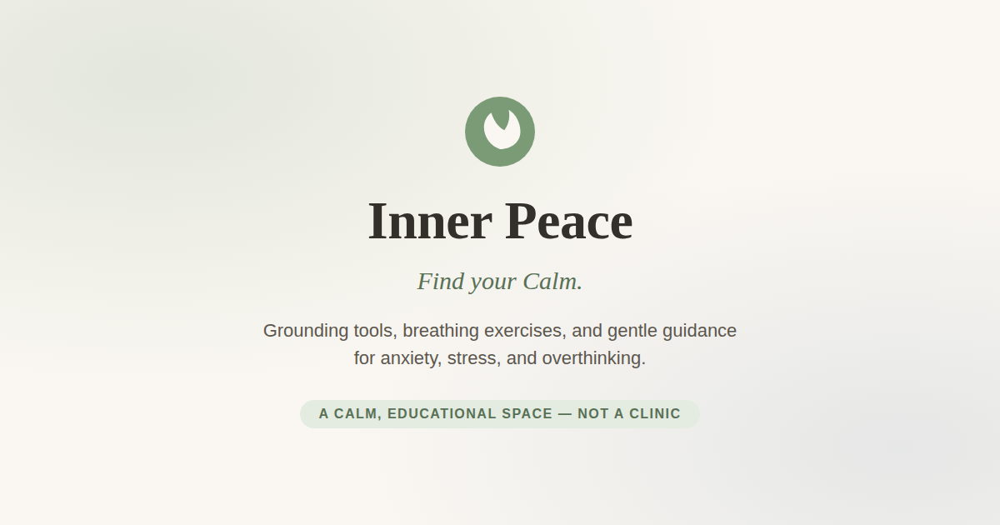

# Inner Peace

**A calm, bilingual (English / Arabic) web app for understanding anxiety, with grounding tools and AI-assisted support that put privacy first.**

[](https://innerpeace-guide.netlify.app/)




**Live:** https://innerpeace-guide.netlify.app/

---

## What it is

Inner Peace is a single-page site that combines **plain-language psychoeducation** about anxiety, GAD, stress, and psychosomatic symptoms with **interactive tools you can use in the moment**. A visitor can choose a situation they're in (or describe it in their own words) and get short, safe, practical suggestions that link straight into a tool such as the breathing exercise.

It was built around three constraints:

1. **Personal data stays in the browser.** There are no accounts and no database. Mood entries and check-in history live only in `localStorage`, and the worry-writing tool doesn't save anything at all.
2. **Safe AI output.** The one AI feature runs behind a server-side function with a strict system prompt, a JSON schema for the response, input limits, and rate limiting.
3. **Accessible and bilingual from the start.** Full English/Arabic content with real RTL layout, a skip link, and respect for `prefers-reduced-motion` across every animation.

> Inner Peace is educational and wellness content only. It is not a substitute for professional medical or mental-health care.

## Features

### Guided support
- **Situation Picker:** pick one of several common situations (e.g. racing thoughts, physical symptoms) for instant, locally served guidance, or describe your own situation for an AI-generated response. The AI also assigns free text to the closest predefined situation so the site can link the right tools.
- **Pattern awareness:** check-ins are recorded locally, so the site can gently point out a situation that keeps coming back.
- **Daily Reframe:** a flip card with a deterministic "reframe of the day".

### Interactive tools
| Tool | What it does |
| --- | --- |
| Breathing Exercise | 4-4-6 paced breathing with an animated guide |
| Relaxation Timer | 5 / 10 / 15-minute sessions with optional background audio |
| Calm Audio Player | Relaxation, sleep, and ambient tracks; falls back cleanly if a file is missing |
| Mood Tracker | Quick mood check-ins with optional notes, stored only in this browser and deletable |
| Thought Dissolver | Write a worry and watch it dissolve on a `<canvas>`; never stored |
| Fidget Pad | Bubble-wrap popping with haptics and a Web Audio-synthesized "pop" (no audio asset) |

Tools can be **deep-linked and auto-started** from a recommendation through a small custom-event bus (`src/lib/startTool.js`), so "read the advice" and "do the exercise" are a single click.

### Educational content
Understanding anxiety, symptoms, psychosomatic effects, lifestyle, therapy, medication (informational only), quotes, and spirituality. All content is fully translated.

## Tech stack

| Layer | Choice |
| --- | --- |
| UI | React 19 (hooks, `useSyncExternalStore`, Context) |
| Build | Vite 8 |
| Styling | Tailwind CSS 4 via `@tailwindcss/vite` |
| Serverless | Netlify Functions (web-standard `Request`/`Response`) |
| AI | Google Gemini API (structured JSON output) |
| Linting | oxlint (React rules-of-hooks enforced) |
| Hosting | Netlify (static `dist/` + functions) |

## Architecture

```
Browser (React SPA)                              Netlify
┌───────────────────────────────────┐          ┌───────────────────────────────────────┐
│ Sections + Tools                  │          │ netlify/functions/situation-support.js│
│ LanguageContext (en/ar, RTL)      │  POST    │  • method + body validation           │
│ useSituationSupport ──────────────┼─────────▶│  • situation-id allowlist             │
│   idle → loading → success/error  │  JSON    │  • 500-char input cap                 │
│ useLocalStorage (mood, history)   │◀─────────┤  • per-IP rate limit (10 / 10 min)    │
└───────────────────────────────────┘          │  • Gemini call w/ responseSchema      │
          ▲  predefined situations             │  • output shape re-validated          │
          └─ resolved locally (no API call)    └───────────────────────────────────────┘
```

- **Predefined situations never reach the network.** They're answered from `src/data/situations.js`. Only free-text descriptions call the function.
- **The function and the client share one source of truth.** The function imports the same `situations` data, so the allowed situation IDs, the classification enum, and the UI can't drift apart.

## Engineering highlights

**AI guardrails** ([`netlify/functions/situation-support.js`](netlify/functions/situation-support.js))
- The API key stays server-side. The browser only ever talks to `/.netlify/functions/situation-support`.
- Gemini's `responseSchema` constrains the output to `acknowledgment` + 2–3 `suggestions` (+ `matchedSituationId` drawn from an enum). The response is **validated again** before it's returned, and an unknown ID falls back to a safe default.
- The system prompt forbids diagnosis, medication or dosing advice, and links, and redirects to emergency help when a description sounds urgent.
- An "anti-spiral" rule for physical symptoms: never list possible conditions. Give reassurance plus one clear signal for when to seek care, so the tool doesn't recreate the experience of googling symptoms.
- Upstream errors are logged on the server and returned to the user as generic messages, so internal details don't leak.

**Security headers** ([`netlify.toml`](netlify.toml))
A strict Content-Security-Policy (`script-src 'self'`, `connect-src 'self'`, `frame-ancestors 'none'`), HSTS with preload, `X-Frame-Options: DENY`, `nosniff`, COOP/CORP, and a locked-down `Permissions-Policy`.

**Accessibility and i18n**
- `LanguageContext` sets `<html lang>` and `dir` together, so Arabic switches the whole document to native RTL. The choice is saved across visits.
- `useReducedMotion` (built on `useSyncExternalStore`) reacts live to the OS setting, and every animated tool honors it.
- Skip-to-content link and semantic sections.

**Resilience**
- Every `localStorage` access is wrapped so private browsing or a full storage quota degrades gracefully instead of crashing.
- The Web Audio and Vibration APIs are progressive enhancements. When either is missing, the visual feedback still works.

**SEO and PWA basics**
Open Graph and Twitter cards, JSON-LD structured data, a canonical URL, sitemap, `robots.txt`, and a web app manifest with icons.

## Project structure

```
src/
├── sections/        # Page sections (Hero, SituationPicker, Symptoms, Therapy, ToolsSection, …)
├── tools/           # Interactive tools (BreathingExercise, MoodTracker, ThoughtDissolver, …)
├── components/      # Reusable UI (Button, Panel, cards, Navbar, DailyReframe, …)
├── data/            # Bilingual content: situations, symptoms, tips, quotes, reframes
├── hooks/           # useLocalStorage, useReducedMotion, useSituationSupport
├── i18n/            # LanguageContext (en/ar + RTL)
└── lib/             # startTool event bus, synthesized pop sound
netlify/functions/   # situation-support.js: Gemini proxy with validation and rate limiting
public/              # Icons, OG image, manifest, sitemap, audio
```

## Getting started

**Prerequisites:** Node.js 20+ and npm. The [Netlify CLI](https://docs.netlify.com/cli/get-started/) is only needed for the AI feature locally.

```bash
git clone https://github.com/RaedElNABOULSI/inner-peace.git
cd inner-peace
npm install
npm run dev            # http://localhost:5173
```

Everything except free-text AI support works with just `npm run dev`.

### Enabling the AI feature locally

```bash
cp .env.example .env   # then set GEMINI_API_KEY
netlify functions:serve   # serves netlify/functions on :9999
npm run dev               # in a second terminal
```

Vite proxies `/.netlify/functions/*` to port 9999 ([`vite.config.js`](vite.config.js)). This keeps HMR working, which the production CSP header would otherwise block under `netlify dev`.

### Environment variables

| Variable | Required | Description |
| --- | --- | --- |
| `GEMINI_API_KEY` | For the AI feature | Google AI Studio API key. Set it in the Netlify dashboard for production and never commit it. |
| `GEMINI_MODEL` | No | Override the Gemini model without a code change (default set in the function). |

### Scripts

| Command | Description |
| --- | --- |
| `npm run dev` | Start the Vite dev server |
| `npm run build` | Production build to `dist/` |
| `npm run preview` | Preview the production build |
| `npm run lint` | Lint with oxlint |

## Deployment

Deployed on Netlify. `netlify.toml` already defines the build command (`npm run build`), the publish directory (`dist`), the functions directory, and the security headers, so connecting the repo and setting `GEMINI_API_KEY` is all that's needed.

## Audio

`public/audio/` holds royalty-free audio for the Calm Audio Player and Relaxation Timer. See [`public/audio/README.md`](public/audio/README.md) for licensing guidance. If a file is missing, the player shows a "coming soon" placeholder instead of a broken control.

## Known limitations and next steps

- **Rate limiting is per function instance and in memory**, so it resets on cold starts. A shared store (e.g. Upstash Redis) would make it reliable under real traffic.
- **No automated tests yet.** Good first candidates: the function's validation paths and the `useSituationSupport` state machine.
- Possible additions: offline support through a service worker, and exporting mood history.

## Disclaimer

Inner Peace provides general educational and wellness information. It does not diagnose, treat, or replace professional care. If you are in crisis, contact your local emergency number or a crisis line right away.

---

Built by [Raed El Naboulsi](https://github.com/RaedElNABOULSI).
